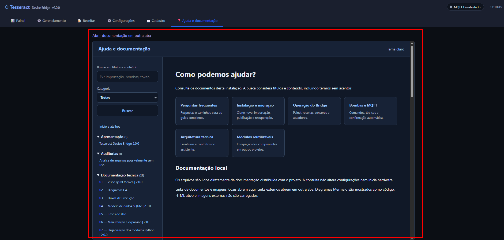

# Tesseract Device Bridge 2.0.0

Automação local de sensores, bombas e aquecimento, com receitas, controle de
temperatura e integração opcional com o Tesseract Core por MQTT.

> **Em homologação:** branch `feature/sqlite-full-migration`.
> Simulação validada pelo mantenedor em 06/11/2026; validação em equipamento real
> pendente. A `main` permanece como versão estável anterior.
> [Situação e critérios de aceite](docs/homologacao/setup-2.0.0.md).

## Início rápido — copiar e colar

Requer Git e Python instalados. Execute em uma pasta onde deseja criar o clone
novo; preserve a instalação anterior como origem da importação.

### Windows — PowerShell

```powershell
git clone --branch feature/sqlite-full-migration --single-branch https://github.com/ChristopherNicolasSMM/Tesseract-Device-Bridge.git Tesseract-Device-Bridge-SQLite
cd Tesseract-Device-Bridge-SQLite
python -m venv venv
.\venv\Scripts\python.exe -m pip install -r requirements.txt
.\venv\Scripts\python.exe -m setup
```

Os comandos usam o Python da venv diretamente, sem precisar ativá-la ou alterar
a política de execução do PowerShell.

### Linux / Raspberry Pi — Bash

Com Python 3.9 e o suporte a `venv` disponíveis:

```bash
git clone --branch feature/sqlite-full-migration --single-branch https://github.com/ChristopherNicolasSMM/Tesseract-Device-Bridge.git Tesseract-Device-Bridge-SQLite
cd Tesseract-Device-Bridge-SQLite
python3.9 -m venv venv
source venv/bin/activate
python -m pip install -r requirements.txt
python -m setup
```

Abra **http://127.0.0.1:8090** no computador onde o setup está rodando e siga o
assistente. No Raspberry sem navegador local, use o
[túnel SSH descrito no manual](docs/manual/20-instalacao-migracao-2.0.0.md).
Não é necessário criar `.env` ou banco antes de iniciar. Concluir o setup não
inicia hardware nem instala/inicia o serviço automaticamente.

## Encontre o que precisa

| Quero… | Abrir |
|---|---|
| Instalar ou migrar a instalação antiga | [Manual de instalação e migração](docs/manual/20-instalacao-migracao-2.0.0.md) |
| Conhecer as telas com imagens | [Guia visual](docs/manual/24-guia-visual.md) |
| Resolver uma dúvida ou falha | [Perguntas frequentes](docs/manual/04-perguntas-frequentes.md) |
| Operar receitas, sensores e atuadores | [Manual de funcionalidades](docs/manual/03-funcionalidades.md) |
| Entender bombas e comandos MQTT | [Bombas e MQTT](docs/manual/16-bombas-mqtt.md) |
| Atualizar, fazer backup ou recuperar | [Manutenção e recuperação](docs/manual/21-manutencao-recuperacao.md) |
| Consultar arquitetura e módulos | [Índice completo da documentação](docs/README.md) |

## Ajuda dentro do painel

A aba **Ajuda e documentação** reúne busca, FAQ e leitura dos manuais locais.
O controle **↔ Layout** permite ajustar a largura das telas.



*Print enviado pelo mantenedor em 06/11/2026, anterior ao botão Layout.
O contorno vermelho destaca a área de conteúdo e não faz parte da interface.*

## Dados e operação segura

A versão 2.0.0 guarda dispositivos, receitas e estados no SQLite. Arquivos
YAML/JSON antigos são origens de importação. Preserve a instalação anterior e
revise dispositivos, calibração e intertravamentos antes de autorizar operação.
O `.env`, bancos e backups operacionais devem permanecer fora do Git.

Detalhes de hardware, motor de receitas, limites e comandos de desenvolvimento
estão na [referência funcional](docs/technical/19-referencia-funcional.md).
