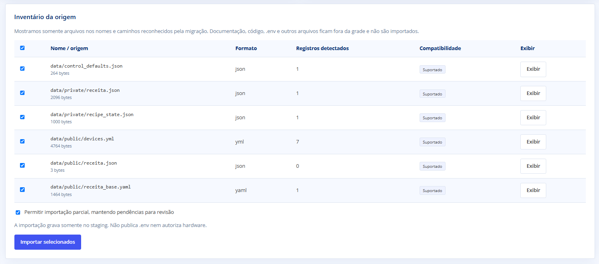
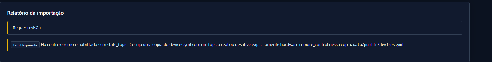
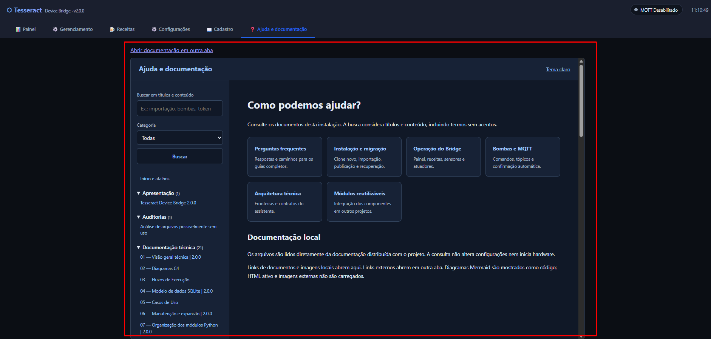

# Guia visual — instalação, importação e ajuda

As imagens foram fornecidas pelo mantenedor em 06/11/2026. Alguns elementos
correspondem a versões anteriores; as legendas indicam as diferenças conhecidas.
Este guia não constitui validação de acionamento físico.

## 1. Descobrir e revisar os arquivos

No setup, abra a preparação de dados, escolha a origem e informe o caminho no
computador servidor. Clique **Descobrir arquivos** e confira o inventário.
O caminho informado deve permanecer preenchido após a busca.

*Exemplo real de inventário de uma instalação anterior. Os nomes e as contagens
variam conforme a origem; “Suportado” identifica o formato, sem aprovar o hardware.*

1. Marque os arquivos que deseja importar.
2. Use **Exibir** para conferir JSON/YAML formatado antes de prosseguir.
3. Decida se permite importação parcial: pendências continuam exigindo revisão.
4. Clique **Importar selecionados** e confira o relatório e os ajustes registrados.

A importação grava no staging. A origem permanece preservada; a publicação é
uma etapa posterior do assistente. Código, documentação, `.env` e arquivos sem
papel reconhecido na migração não devem aparecer na grade de candidatos.

[Passo a passo completo da importação](16-importacao-navegador.md).

## 2. Tratar controle remoto incompleto

*Mensagem registrada antes do diálogo de resolução. Serve para identificar a
causa; no fluxo atual, revise a escolha no diálogo oferecido pelo assistente.*

Para um dispositivo remoto sem `state_topic`, escolha entre manter o controle
remoto e informar o tópico real, ou desabilitar essa permissão nos dispositivos
inconsistentes da cópia importada. Não há escolha automática. Confira os ajustes
no relatório antes de continuar. O arquivo antigo não é reescrito.

O tópico de estado informa a situação do atuador; o comando usa `command_topic`.
Apenas preencher um nome de tópico não comprova conectividade nem autorização
para ligar uma bomba. Veja [Bombas e MQTT](16-bombas-mqtt.md).

## 3. Consultar ajuda durante o uso

*Print anterior ao controle Layout. O contorno vermelho foi desenhado pelo
mantenedor para destacar a área de conteúdo.*

Abra **Ajuda e documentação** no painel. Pesquise por palavras como “importação”,
“bombas” ou “token”, escolha uma categoria e abra um documento. Links entre
manuais permanecem no leitor. A central também tem acesso pelo setup.

Para ajustar a largura, use **↔ Layout** no cabeçalho do aplicativo. Dentro da
aba de ajuda, o leitor acompanha a largura do painel. Consulte os
[modos de layout](23-layout-interface.md) e o [guia da central](22-ajuda-documentacao.md).

## Se algo falhar

| Sintoma | Próximo passo |
|---|---|
| Sessão/CSRF inválido, HTTP 403 | Renovar sessão, revisar os campos e enviar novamente. |
| Origem não encontrada ou importação falhou | Conferir caminho, permissões e ID do diagnóstico; baixar o log. |
| Controle remoto sem tópico | Resolver a escolha no diálogo e revisar os ajustes. |
| Dúvida sobre concluir ou recuperar | Consultar instalação e manutenção antes de alterar o banco. |

[FAQ](04-perguntas-frequentes.md) · [Logs do setup](15-setup.md#logs-de-diagnóstico-setup18) ·
[Instalação](20-instalacao-migracao-2.0.0.md) · [Manutenção](21-manutencao-recuperacao.md).
