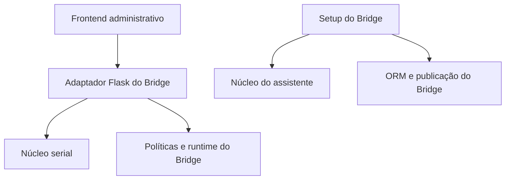

# Guia de arquitetura para reaproveitamento

## Direção das dependências

`reusable/serial_monitor/` e `reusable/guided_setup/` são bibliotecas irmãs.
Não dependem uma da outra e não importam o aplicativo hospedeiro. A raiz
`reusable/__init__.py` não inicializa subsistemas. Flask, dotenv e pyserial são
carregados nas funções que os utilizam, permitindo usar só uma das partes.

| Camada | Deve conter | Não deve conter |
|---|---|---|
| Núcleo serial | Validação nativa, abertura, leitura, ownership, timeout e fechamento | Cadastro de dispositivos, token HTTP, receitas, GPIO |
| Núcleo do assistente | Lock, JSON atômico, atualização dotenv, host/porta, layout e navegação | Schema de dispositivos, migração de brassagem, systemd específico |
| Adaptador do Bridge | Tradução de erros, prefixos/configuração, rotas e intertravamentos | Segunda implementação dos mecanismos genéricos |
| Frontend | Operações explícitas, estado da tela, renderização segura | Decidir autorização ou escrever diretamente em banco/porta |

## Onde estão os adaptadores

- `tesseract_bridge/diagnostics/service.py`: compatibilidade das funções antigas
  `serial_ports`/`serial_read` e singleton do monitor no processo.
- `panel/admin_diagnostics.py`: autenticação herdada do blueprint, sessão do
  navegador, validação de corpo e verificação de sessão operacional antes de
  abrir/testar/ler; encerra a conexão do proprietário quando essa guarda falha.
- `panel/templates/_serial_monitor.html` e `panel/static/serial-monitor.js`: UI
  compartilhada pelas páginas administrativa e de configuração sem dispositivos;
  recebe o callback HTTP autenticado da aplicação.
- `setup/state.py`: schema de estado, staging, recibo e cancelamento específicos;
  delega lock e gravação JSON ao núcleo.
- `setup/infrastructure.py` / `security.py`: prefixos, candidatos privados e
  credenciais; delegam validação genérica e edição dotenv ao núcleo.
- `setup/app.py`: etapas e blueprints do produto, sessão, loopback/origem/CSRF.
- `setup/templates/base.html`: identidade do Bridge e scripts específicos sobre
  `guided_setup/base.html`. O layout e os estilos ficam no componente.
- `shared_ui/__init__.py`: mantém a URL `/shared-ui/theme.css`, servindo o tema
  do componente. Painel e setup continuam compartilhando a mesma fonte CSS.

## Como levar para outro projeto

1. Instale `./reusable` com apenas os extras necessários, ou copie o pacote
   `reusable/` preservando sua estrutura de imports e recursos estáticos.
2. Crie um adaptador no novo projeto, sem adicionar imports dele dentro do núcleo.
3. Forneça autenticação/intertravamentos para serial, e schema de estado,
   validações, tradução, publicação e políticas de rede para o assistente.
4. Troque marca, catálogos e lista de etapas; reutilize os blocos do template.
5. Teste o adaptador sem hardware, depois valide as portas/permissões no SO alvo.

Reaproveitar o instalador não significa copiar migrações Alembic, `.env` do
usuário, recibos existentes ou scripts systemd do Bridge. Esses arquivos são
específicos de uma instalação/produto. Os componentes não detectam nem publicam
bancos por conta própria.

## Evolução

A versão atual é `0.1.1`, com navegação de pastas adicionada de forma compatível
ao contrato inicial `0.1.0`. Preserve as funções de compatibilidade do Bridge;
novos recursos devem entrar primeiro no núcleo quando forem independentes do
domínio. Recursos específicos entram em adaptadores. Mudanças incompatíveis
nos parâmetros/resultados exigem versão e guia de migração do componente.

O monitor é local ao processo. Múltiplos workers HTTP exigem um serviço/broker
único de portas; não basta criar um singleton em cada worker. A proteção de
sessão do monitor não substitui permissões do SO nem reserva a porta contra
outros programas. O setup segue com um processo e lock exclusivo da instalação.

## Documentação como módulo de consulta

`reusable/documentation` concentra catálogo, busca, renderização e frontend.
`shared_ui/documentation.py` configura o escopo público do Bridge. Painel, setup
e configuração inicial registram o mesmo componente sem criar runtime.
Falhas do leitor não passam pelo tratador de emergência do painel.
Consulte [contratos e integração](documentation/README.md).

## Largura de conteúdo como preferência visual

`reusable/ui_preferences` publica o controle Layout. A preferência vive apenas no
navegador, com adaptadores de CSS por superfície. Documentação independente usa
nonce para o script confiável; o iframe herda a escolha sem habilitar scripts.
[Arquitetura e contratos](ui-preferences/README.md).
