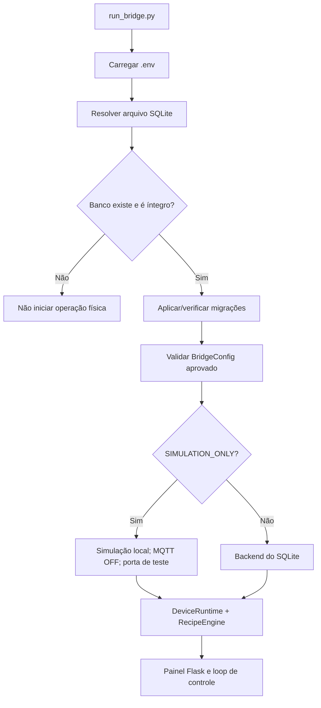

# 01 — Visão geral técnica | 2.0.0

**Status:** arquitetura SQLite em homologação na branch
`feature/sqlite-full-migration`, sem alteração da `main`.

## Objetivo e limites

O Device Bridge é o processo de automação local do Raspberry Pi:
recebe sensores, aciona atuadores com failsafe, controla temperatura
(PID + time-proportioning), executa receitas e pode integrar-se ao
Tesseract via MQTT. O núcleo de controle continua independente do banco
durante os ciclos críticos: configurações aprovadas são convertidas em
objetos e snapshots em memória.

## Módulos da versão 2.0.0

> Consulte [Organização dos módulos](07-organizacao-python.md). O pacote interno `tesseract_bridge/` agrupa infraestrutura, segurança, controle e integrações, mantendo entrypoints na raiz.

| Componente | Responsabilidade |
|---|---|
| `run_bridge.py` | Inicialização integral: banco, configuração, DeviceRuntime, RecipeEngine, MQTT e painel |
| `run_panel.py` | Painel isolado, utiliza os mesmos parâmetros de infraestrutura |
| `tesseract_bridge/infrastructure/env.py` / `.env` | Arquivo de instalação e overrides de processo |
| `storage/migrate.py` + `storage/migrations/` | Migrações do esquema SQLite |
| `storage/sqlite_store.py` | Conexões, transações, entidades, revisões e backup |
| `storage/legacy_import.py` | Conversão **apenas por comando explícito** |
| `data/__init__.py` | Fachada de receitas no armazenamento SQLite |
| `panel/api.py` | Endpoints operacionais e de receitas/controle térmico |
| `panel/admin_api.py` | Administração, rascunhos, aprovação, auditoria e backup |
| `panel/static/admin-sqlite.js` | Interação de administração no frontend |
| `device_runtime.py`, `tesseract_bridge/control/` e `recipe_engine/` | Segurança e execução em memória |
| `data/private/*.sqlite3` | Banco local (ignorado pelo Git) |

## Inicialização

Caminho de banco: `TESSERACT_BRIDGE_DB` ou
`data/private/bridge.sqlite3` por padrão. `TESSERACT_BRIDGE_DB`
explicitamente informado mas inexistente bloqueia a inicialização do
Bridge até executar importação/inicialização. Para ambiente novo,
`python -m storage.cli init` cria o banco simulado.

## Administração e segurança

O inventário mostra o estado **do snapshot operacional atual**. O
frontend administrativo edita a revisão persistida em fluxo separado:
obter configuração → criar rascunho → validar referências/segurança →
aprovar revisão → reiniciar o processo em condição segura.

`TESSERACT_BRIDGE_ADMIN_TOKEN` protege somente `/api/admin/*`;
não é autenticação global nem autorização para publicar o painel na
Internet. O modo simulado força host `127.0.0.1` e MQTT desabilitado.
Antes de produção, revisar autenticação, CSRF, transporte e proteção
de endpoints operacionais.

## API SQLite administrativa

| Verbo | Rota | Uso |
|---|---|---|
| GET | `/api/admin/config` | Configuração aprovada e revisão |
| GET | `/api/admin/drafts` | Lista rascunhos recentes |
| POST | `/api/admin/drafts` | Valida e persiste um rascunho |
| POST | `/api/admin/drafts/<id>/activate` | Aprova para próximo boot |
| GET | `/api/admin/storage` | Status do banco |
| GET | `/api/admin/audit` | Eventos recentes |
| POST | `/api/admin/backup` | Criar backup consistente |
| GET | `/api/admin/backup/<filename>` | Baixar backup criado |

As rotas administrativas exigem o header
`X-Bridge-Admin-Token` com o valor do `.env`.

## Dependências e testes

- Python 3.9.x obrigatório com backend físico no Raspberry Pi.
- `sqlite3` da biblioteca padrão, `Flask`, `PyYAML` somente para migração,
  `python-dotenv` para infraestrutura, `pytest` para regressões.
- `python -m storage.cli status` mostra banco, revisão, cadastros e
  configurações efetivas do processo.
- `python -m pytest -q` executa a suíte; homologação física depende de
  revisão específica de sensores, bombas, resistências e GLP.

## Documentos associados

- [Manual de administração](../manual/13-administracao-sqlite.md)
- [Migração, importação e rollback](../manual/12-sqlite-migracao.md)
- [Modelo de dados SQLite](04-modelo-de-dados.md)
- [Primeiros passos da 2.0.0](../manual/02-primeiros-passos.md)
