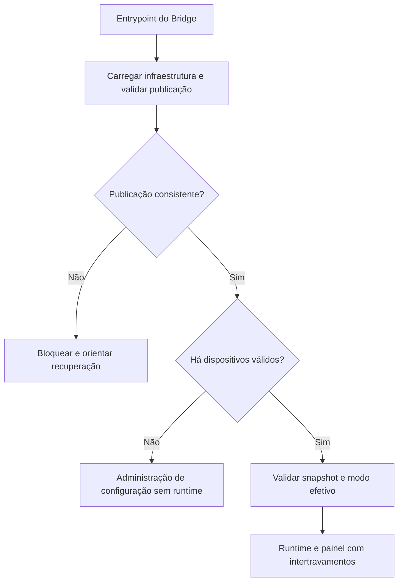

# 01 — Visão geral técnica | 2.0.0

Branch: `feature/sqlite-full-migration`. Implementação disponível, homologação
final pendente; consulte as [evidências](../homologacao/setup-2.0.0.md).

## Arquitetura atual

O Bridge controla sensores/atuadores e receitas com snapshots em memória.
PID, time-proportioning e intertravamentos não consultam SQLite a cada ciclo.
O setup é um processo independente: prepara dados/configuração e publica a
instalação; não inicializa GPIO, MQTT ou runtime durante sua abertura.

| Camada | Componentes e contrato |
|---|---|
| Instalador do produto | setup/: estado, importadores, bootstrap ORM, candidatos .env e publicação |
| Componentes reutilizáveis | reusable/serial_monitor e reusable/guided_setup, sem dependência do domínio |
| Infraestrutura/boot | tesseract_bridge/infrastructure: env, paths, identidade e recibo |
| Persistência | storage/store_router.py seleciona ORM ou compatibilidade legacy; sem escrita dupla |
| ORM | storage/models, repositories e Alembic até bridge_orm_0003 |
| Runtime | device_runtime.py, control/ e recipe_engine/: segurança/controle em memória |
| Painel | panel/api.py operacional; admin_api/admin_diagnostics para manutenção autorizada |
| Configuração vazia | panel/configuration_app.py, sem DeviceRuntime; inclui monitor serial explícito |
| Recursos visuais | Tema do módulo guiado servido também por shared_ui; UI serial compartilhada |

Instalações novas usam `python -m setup`, sem `.env` ou banco prévios. O destino
publicado é `data/private/bridge.sqlite3`, com STORAGE_MODE=orm. `storage.cli init`
e migrações SQL legadas são caminhos de compatibilidade, não bootstrap do setup.

## Inicialização e guarda operacional

O recibo `data/private/installation.json`, INSTALL_ID e identidade SQLite são
verificados pelo bootstrap. Publicação interrompida bloqueia boot; needs_review
mantém simulação. O modo real ORM exige ready_operational e autorização explícita
na conclusão/revalidação. Não há barreira ORM adicional após setup válido.
Sandboxes históricos explicitamente simulados preservam a compatibilidade prevista.

SIMULATION_ONLY=1 força backend simulado, MQTT desligado e painel de testes em
loopback. Backend físico mantém a exigência existente de Python 3.9 e validações
de hardware. Concluir setup não certifica fiação, chama ou atuadores.

## Administração e diagnóstico

As rotas /api/admin/* herdam token ou política local explícita. Token pode ser
gerado/customizado; valor curto é aceito com aviso. Sem token, LOCAL_ADMIN exige
cliente/Host de loopback, origem/CSRF e recusa de proxies. Essa política não é
autenticação global dos endpoints operacionais do painel.

Configuração segue rascunho → validação → aprovação → reinício seguro. O inventário
reflete o snapshot atual; aprovar banco não remapeia GPIO em execução. Backup
administrativo copia consistentemente o banco, não todo o conjunto de instalação.

Diagnósticos incluem 1-Wire, GPIO virtual e serial. O serial lista portas do SO
ou aceita endereço nativo manual, sem cadastro; permite teste de abertura e
leitura pontual/contínua. Autenticação e guarda operacional são adaptações do
Bridge, enquanto conexão, ownership, limites e expiração pertencem ao módulo.
Não existe transmissão de comandos seriais nessa interface.

## Referências de engenharia

- [Organização dos pacotes](07-organizacao-python.md)
- [Arquitetura do setup](18-setup-arquitetura.md)
- [Componentes e integração em outros projetos](../modules/arquitetura.md)
- [Modelo de dados e compatibilidade](04-modelo-de-dados.md)
- [Manutenção e expansão](06-manutencao-e-expansao.md)
- [Manual consolidado](../manual/20-instalacao-migracao-2.0.0.md)
