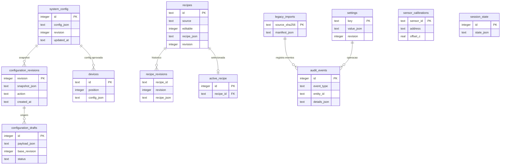

# 04 — Modelo de dados SQLite | 2.0.0

> **Estado da versão:** em homologação na branch
> `feature/sqlite-full-migration`. Esquema real em
> `storage/migrations/0001_initial.sql` e `0002_indexes.sql`.
> Os desenhos YAML/JSON anteriores são referência histórica da 1.x,
> não fonte de dados operacional da 2.0.0.

## Visão relacional

*As linhas acima resumem vínculos conceituais. Nem todos são chaves
estrangeiras físicas no SQLite; consulte os scripts SQL para constraints
exatas. Em particular, a seleção da receita usa FK e a tabela de revisões
de receita não possui FK declarada.*

## Entidades e responsabilidades

| Tabela | Conteúdo | Observações |
|---|---|---|
| `schema_migrations` | versão, nome, checksum SHA-256 e momento da execução | Detecta alteração de arquivo SQL já aplicado |
| `system_config` | MQTT, backend, painel e revisão aprovada em JSON | Linha única `id=1` |
| `devices` | IDs, ordem e configuração física completa | Dados operacionais |
| `configuration_revisions` | snapshots da configuração e ação de origem | Histórico de revisões |
| `configuration_drafts` | rascunho e revisão-base | Status `draft/applied/discarded` |
| `recipes` | ID `public:...`/`private:...`, dados de receita, versão, editabilidade | `public:base` é protegida |
| `recipe_revisions` | versões anteriores das receitas | Não é histórico completo de sessão |
| `active_recipe` | receita escolhida para próximo boot | ID de receita como FK |
| `settings` | parâmetros de controle e padrão de fábrica | Chaves `control` e `control_factory` |
| `sensor_calibrations` | ROM ID, sensor e offset (−5 a +5 °C) | Não aplicar automaticamente após troca física |
| `session_state` | snapshot persistido da sessão | Recuperação segura; jamais religar atuadores após falha |
| `audit_events` | eventos administrativos persistidos | Não registra toda leitura GPIO |
| `legacy_imports` | manifesto da importação e hashes da origem | Permite conferir a proveniência |

## Fluxos e integridade

- **Controle em tempo real:** SQLite não é chamado a cada ciclo de PID/GPIO.
- **Revisões:** o operador cria rascunho, valida configurações, aprova e
  reinicia quando seguro. A execução ativa permanece no snapshot anterior.
- **Receita:** `public:base` continua protegida; receitas normais mantêm
  `public:` ou `private:` como identificadores lógicos, **não** pastas
  distintas no Git.
- **Parâmetros:** o estado de uma execução de receita conserva o snapshot
  de configurações aplicadas. Alterar formulário térmico não altera a
  sessão já em andamento.
- **Calibração:** ROM ID e offset devem corresponder ao sensor físico;
  correção só entra no próximo boot.
- **Falha:** banco ausente/corrompido não deve liberar saídas físicas;
  retomar estados interrompidos requer decisão explícita e fail-safe.
- **Importação:** somente `tools/migrate_legacy_to_sqlite.py` acessa
  YAML/JSON antigos. A origem e o backup são preservados.

## Migração e durabilidade

Arquivos SQL versionados são aplicados antes da operação. Conexões SQLite
usam `foreign_keys=ON`, `busy_timeout`, journal DELETE e
`synchronous=FULL`. O backup utiliza a API nativa do SQLite.

O banco não deve ser versionado no Git. Mantenha cópias externas,
conferência de integridade e permissões restritas. Em serviços systemd,
verifique a identidade do usuário que escreve no diretório privado.

Mais detalhes: [administração](../manual/13-administracao-sqlite.md) e
[importação](../manual/12-sqlite-migracao.md).
