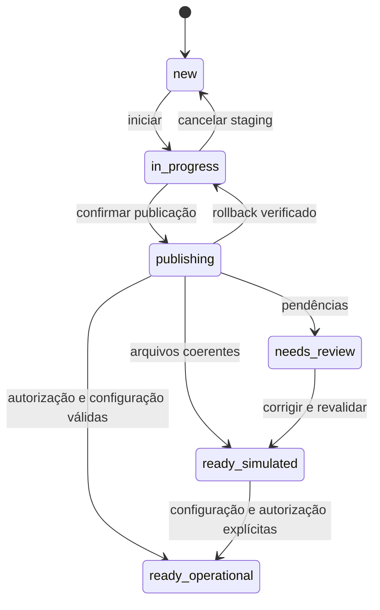

# Arquitetura consolidada do setup 2.0.0

## Escopo e fronteiras

setup/ é um módulo CLI/Flask independente. Abrir o assistente não importa run_bridge,
panel.app, DeviceRuntime, GPIO ou MQTT. O pacote shared_ui serve recursos estáticos
sem depender do painel operacional. Bibliotecas ORM são carregadas sob demanda
nos serviços de importação/bootstrap/publicação, sem inicializar controle físico.

| Componente | Responsabilidade |
|---|---|
| setup.__main__ / app | Servidor local, sessão, CSRF, origem, registro de blueprints |
| state | Lock do SO, manifesto privado versionado, staging e cancelamento |
| bootstrap | ORM vazio, Alembic até 0003, perfis/cabeçalhos mínimos |
| legacy / partial | Captura limitada de YAML/JSON, validação e conversão parcial explícita |
| sqlite_import | Captura de banco consistente, detecção de esquema, normalização/upgrade em cópia |
| uploads / browser_import | Contrato de bytes e adaptador HTTP/inventário/prévia |
| reports / i18n | Eventos estáveis, persistência sanitizada e tradução de exibição |
| infrastructure / security | Candidatos .env privados, validação e credencial |
| publication / finalize | Confirmação, publicação, retomada, rollback e revalidação |
| service | Geração de unidade e ações privilegiadas via tools/ |
| doctor / version | Diagnóstico sem efeitos e build único |
| infrastructure.installation | Guarda de boot/ORM sem dependência de Flask/setup/ORM |
| panel.configuration_app | Administração de instalação vazia sem DeviceRuntime |

## Componentes reutilizáveis

Lock, gravação JSON atômica, validação host/porta, teste de bind e atualização
dotenv estão em `reusable/guided_setup/`. O registro visual utiliza WizardStep,
layout Jinja e CSS do componente; o template do Bridge apenas adapta marca e
scripts. `shared_ui` preserva a URL do tema, servindo a mesma fonte CSS.

A migração ORM, schema de estado, staging, credenciais e publicação continuam
nos adaptadores do Bridge. Veja o [guia do componente](../modules/guided-setup/README.md)
e o [guia de arquitetura](../modules/arquitetura.md), com exemplo de integração
em outro projeto e responsabilidades que o hospedeiro precisa implementar.

## Ciclo de estado

publishing pertence ao receipt de publicação, enquanto o manifesto do assistente
pode ainda estar in_progress. Não confundir esses dois arquivos ou exigir que suas
gravações ocorram numa transação SQLite. O doctor detecta divergência de estado.

O manifesto setup/state.json usa versão 1 e mantém attempt/idioma/aparência,
referências de candidatos e relatórios. installation.json usa versão 1 e registra
status, ID, caminho relativo do banco, application_id, hashes de publicação,
resumo e diretório do job. Campos adicionais não equivalem a liberação de hardware.

## Locks, transações e publicação

Uma tentativa por clone usa flock em POSIX e msvcrt no Windows; o SO libera o lock
ao encerrar o processo. Conexões SQLite são fechadas explicitamente, e engines ORM
usam sessões curtas. Atualizações de domínio mantêm as transações existentes com
verificação de revisão; não há escrita dupla legacy/ORM.

O protocolo final não promete atomicidade conjunta de dois arquivos:
1. validar candidatos e origem .env inalterada;
2. capturar DB/candidato .env e backup anterior privados;
3. gravar receipt publishing com fsync/replace;
4. publicar DB exclusivamente e trocar/criar .env conforme consentimento;
5. gravar status final do receipt e depois manifesto.

Cópias novas são sincronizadas antes de hard link exclusivo no mesmo filesystem.
Não há fallback que exponha banco parcial. Em erro, o receipt continua bloqueando
boot; recovery valida os hashes e retoma sem sobrescrita indevida.
Rollback só existe para publicação incompleta e arquivos reconhecidos.
Uma instalação concluída é restaurada por conjunto de backup, não por downgrade.

Runtime valida modo ORM, estado concluído, caminho/ID e application_id da base.
O hash inicial do DB não é condição permanente, porque o runtime precisa gravar.
Mudança de configurações físicas continua sujeita às validações e intertravamentos
de domínio; metadados de setup não removem esses controles.

Sandboxes ORM históricos continuam permitidos em simulação sem receipt gerenciado.
Operação configurada exige publicação/revalidação aprovada. O suporte legacy existente
permanece fora do fluxo novo e não recebe migração implícita.

## Contratos de importação

- Origem explícita, somente leitura, descoberta limitada a caminhos reconhecidos.
- Captura de arquivos limitada e conferida por hash; origem antiga deve estar parada
  para consistência entre múltiplos arquivos.
- SQLite é inspecionado em cópia; sidecars são recusados e não removidos.
- Revision 0001/0002/0003 conhecida; revisão futura não é adivinhada.
- YAML seguro; arquivos desconhecidos e ZIP não são executados/extraídos.
- Importação parcial precisa de consentimento; erros críticos não são ignoráveis.
- database=None em falha crítica; needs_review não libera operação física.
- Eventos: imported/warning/blocking_error/ignored e código estável. Conteúdo arbitrário
  de exceções não é persistido em relatório nem usado como HTML.
- IDs de prévia são resolvidos contra inventário servidor-side; não viram caminhos livres.
- Repetição cria job novo; não sobrescreve candidatos ou origem.

Upload aceita bytes com nomes de destinos reconhecidos, limites por arquivo/conjunto
e rejeição de traversal/duplicatas. O navegador pode acrescentar arquivos a um inventário
de upload existente, mantendo seleção explícita de destinos ambíguos.
O importador decide compatibilidade; extensão/MIME sozinhos não comprovam validade.

## HTTP, credenciais e recursos

Bind padrão 127.0.0.1, sem debugger/reloader. Host local e cliente loopback são
checados. POST exige sessão/CSRF e Origin exata; quando Origin ausente, exige
Referer da mesma origem. Cookies HttpOnly/SameSite Strict são específicos da porta.
CSP, nosniff, no-store e recursos estáticos versionados acompanham respostas.

Setup não expõe terminal, execução SQL, scripts enviados ou sudo via HTTP.
Token gerado é exibido uma vez por segredo temporário em memória servidor-side;
o cookie carrega somente ID opaco. Custom token curto é aceito com aviso.
ADMIN_TOKEN_B64 é serialização, não criptografia; arquivos permanecem privados.

Sem token exige LOCAL_ADMIN explícito. Runtime força painel em loopback, recusa
headers de proxy e Host remoto e exige CSRF para alterações administrativas.
Com token, integrações mantêm cabeçalho textual, com suporte adicional a base64 UTF-8.
A política de /api/admin não constitui autenticação de toda rota /api ou do MQTT.

pt_BR/en usam JSON com chaves estáveis. Tradução ocorre em Jinja, mensagens HTTP e
eventos exibidos; IDs persistidos não são traduzidos. CSS comum está em shared_ui,
e shell do setup usa padrões visuais do Tesseract principal sem importar seu runtime.

## Serviço e instalação vazia

O modo vazio permite leitura administrativa não operacional explicitamente;
BridgeConfig.validate permanece exigindo dispositivos para runtime.
configuration_only desvia o início antes de criar backend/runtime ou conectar MQTT.

Ações systemd são separadas. tools/*.sh delegam --setup-managed ao mesmo adaptador,
com verify antes de instalar, destino exclusivo, ID/hash de ownership, usuário
não-root e rollback do inode criado se a instalação falhar. Não há início automático.

## Evidências e limitações

A suíte local fornecida pelo usuário é evidência somente da versão e plataforma
efetivamente executadas. CI configura Ubuntu/Windows e Python 3.9/3.13, mas não
certifica hardware nem serviço físico. Resultados e pendências estão na
[matriz de homologação](../homologacao/setup-2.0.0.md).
